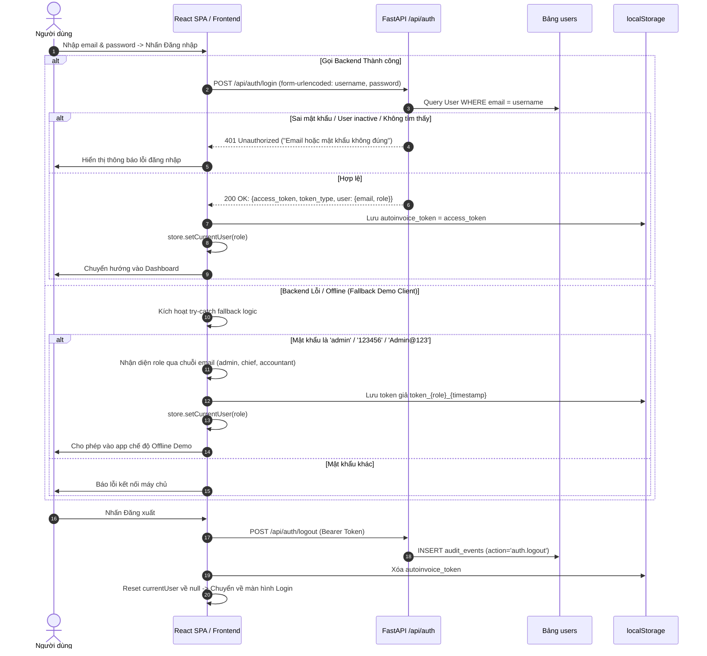
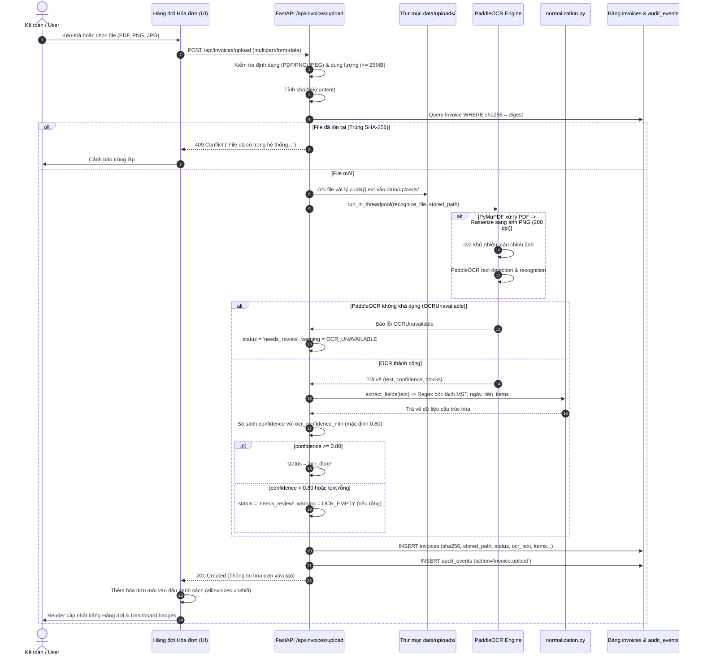
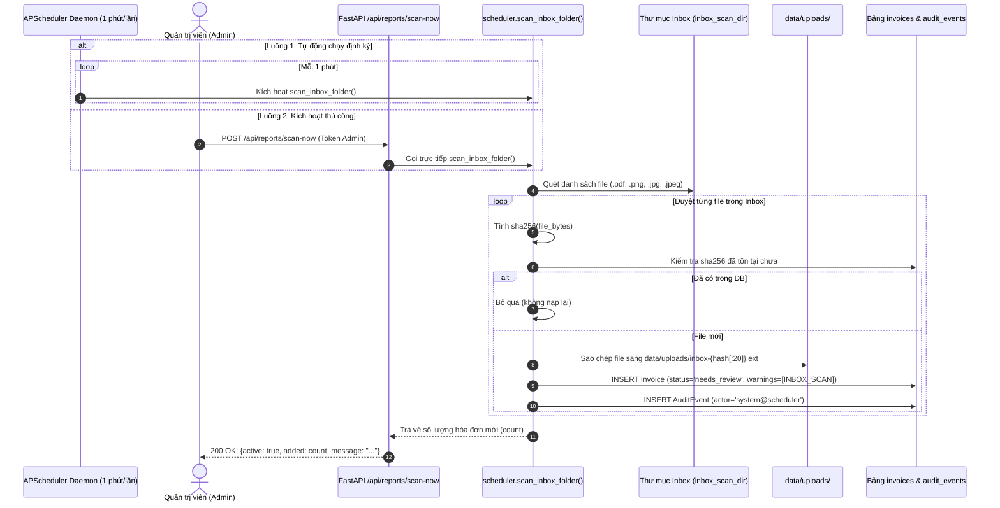
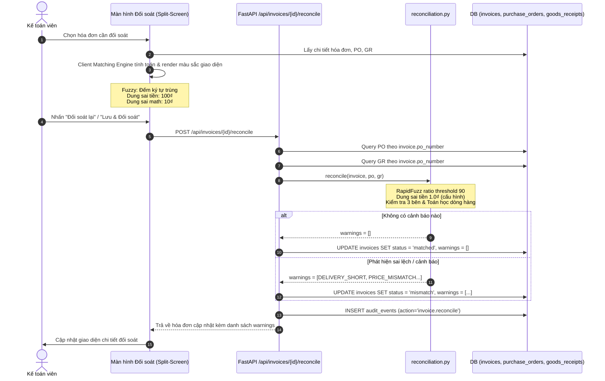
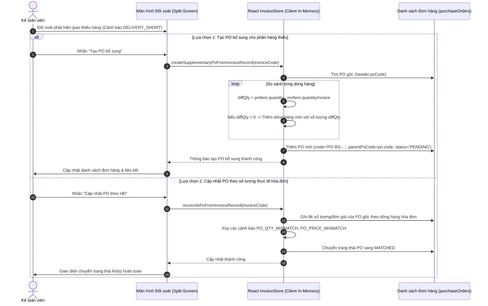
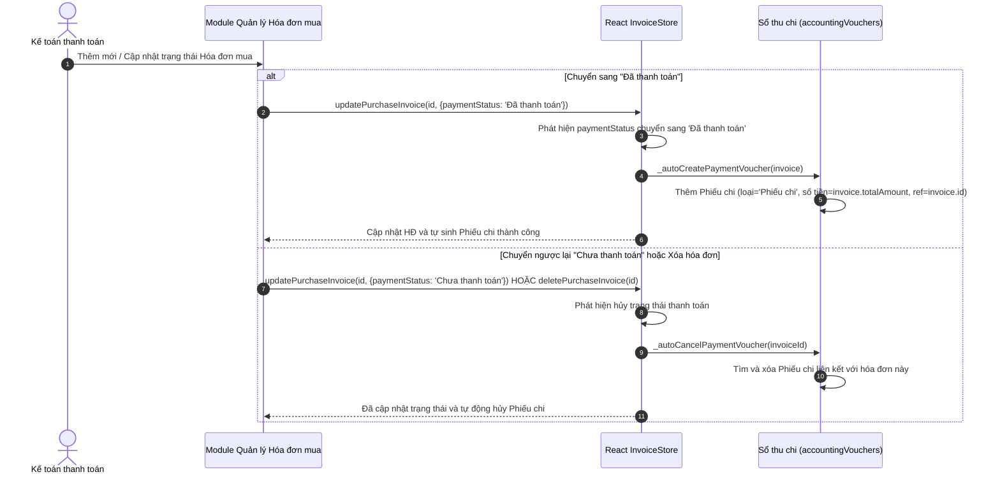
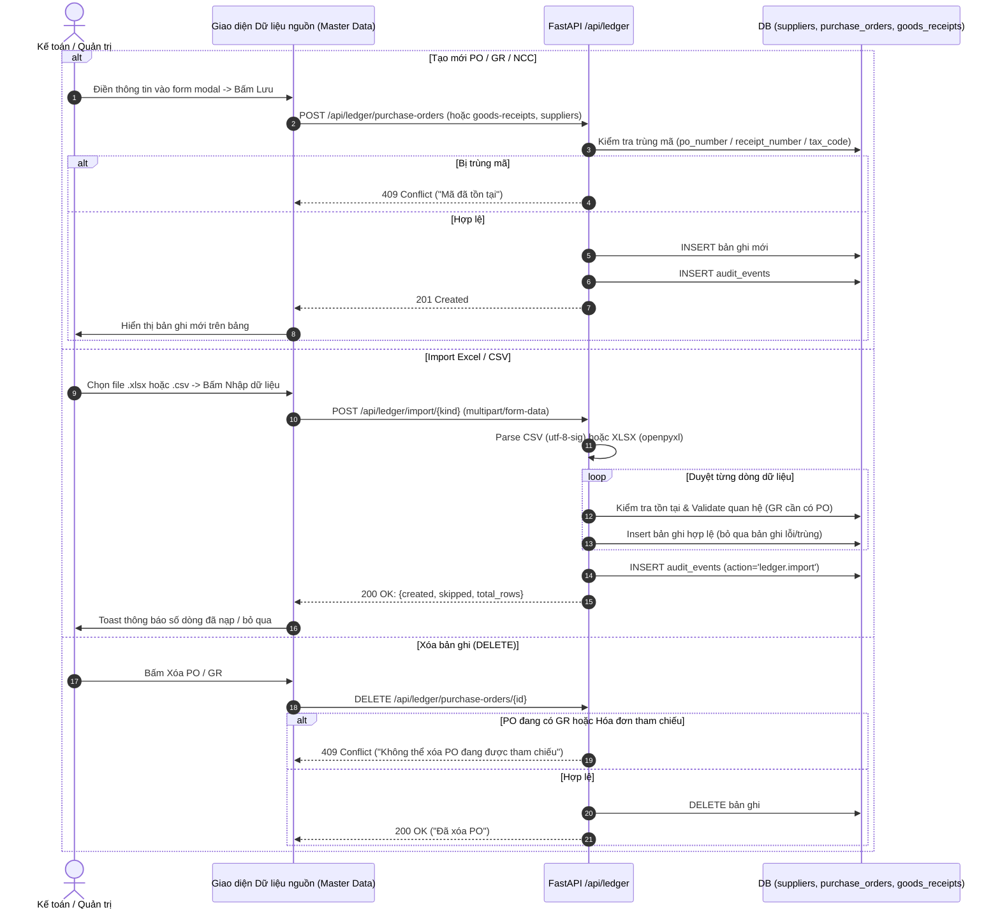
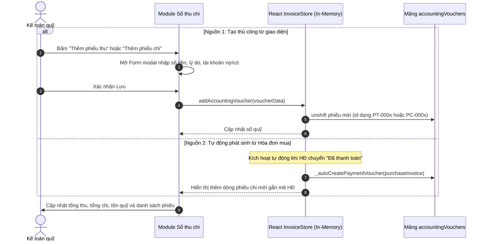
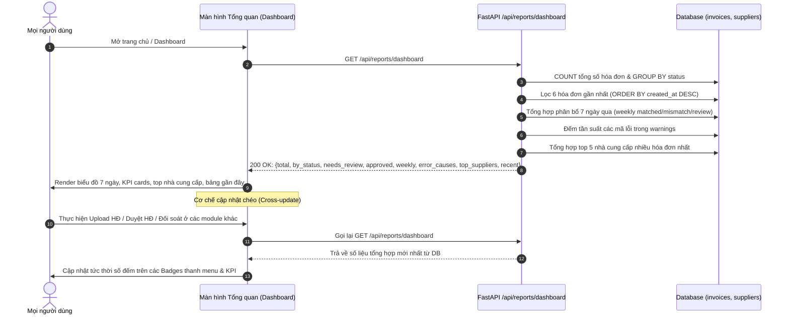
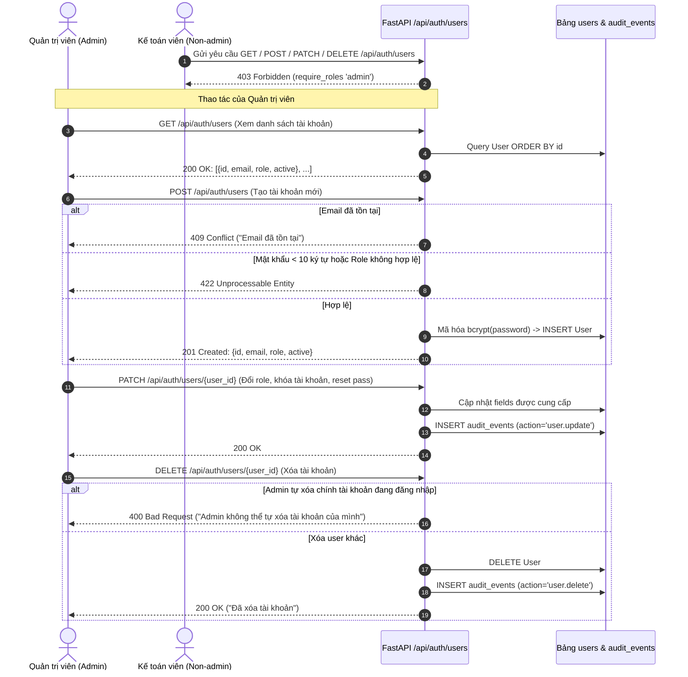

# CHI TIẾT CÁC LUỒNG HOẠT ĐỘNG CỦA CÁC MODULE (AUTOINVOICE RPA)

> **Tài liệu đối soát mã nguồn thực tế**: Khảo sát trực tiếp từ Backend FastAPI (`backend/app/`), React SPA Bundle (`frontend/assets/index-CIEau9oz.js`), và Vanilla Frontend (`frontend/src/app.js`).
> Mọi bước, mã lỗi, điều kiện rẽ nhánh và phân quyền đều có dẫn chứng file:dòng chính xác.

---

## BẢNG TỔNG HỢP CÁC LUỒNG (L1 – L12)

| Mã | Luồng Nghiệp Vụ | Nơi Chạy | Phân Quyền Cho Phép | Dữ Liệu Đọc / Ghi | File:Dòng Dẫn Chứng |
|---|---|---|---|---|---|
| **L1** | Đăng nhập, Đăng xuất, Fallback & Đổi mật khẩu | [CẢ HAI] | Mọi User / Fallback demo | Đọc/Ghi bảng `users`, `audit_events`, `localStorage` | `backend/app/api/auth.py:36-69`<br>`index-CIEau9oz.js: dòng 1` |
| **L2** | Upload Hóa đơn -> SHA256 -> OCR -> Chuẩn hóa | [BACKEND-API] | Mọi User đăng nhập | Ghi file `data/uploads/`, bảng `invoices`, `audit_events` | `backend/app/api/invoices.py:54-103`<br>`services/ocr.py`, `services/normalization.py` |
| **L3** | RPA Quét Inbox tự động (APScheduler) & Quét ngay | [BACKEND-API] | Quét tự động: System<br>Quét ngay: `admin` | Đọc thư mục inbox, copy file, ghi bảng `invoices` | `backend/app/services/scheduler.py:13-41`<br>`backend/app/api/reports.py:87-93` |
| **L4** | Đối soát 3 bên (3-Way Matching): Backend vs Client | [CẢ HAI] | Mọi User xem & chạy đối soát | Đọc `invoices`, `purchase_orders`, `goods_receipts` | `backend/app/api/invoices.py:182-192`<br>`services/reconciliation.py:14-95` |
| **L5** | HITL: Sửa tay -> Lưu Review -> Duyệt / Từ chối | [BACKEND-API] | Sửa/Review: Mọi user<br>Duyệt: `chief_accountant`, `admin` | Ghi bảng `invoices` (`status`, `review_note`), `audit_events` | `backend/app/api/invoices.py:162-205`<br>`frontend/src/app.js:649-694` |
| **L6** | Xử lý Giao thiếu/sai: Tạo PO bổ sung & Sửa PO | [CLIENT-MOCK] | Kế toán, Quản trị | Đọc/Ghi `store.purchaseOrders`, `store.invoices` (In-memory) | `index-CIEau9oz.js: dòng 1`<br>(`createSupplementaryPoFromInvoiceRecord`) |
| **L7** | Quản lý HĐ mua & Tự động sinh/hủy Phiếu chi | [CLIENT-MOCK] | Kế toán, Quản trị | Đọc/Ghi `store.purchaseInvoices`, `store.accountingVouchers` | `index-CIEau9oz.js: dòng 1`<br>(`_autoCreatePaymentVoucher`) |
| **L8** | Master Data (PO, GR, NCC, Sản phẩm...) & Import | [CẢ HAI] | Mọi User (riêng xóa toàn bộ cần `admin`) | Đọc/Ghi bảng `suppliers`, `purchase_orders`, `goods_receipts` | `backend/app/api/ledger.py:53-226`<br>`index-CIEau9oz.js: dòng 1` |
| **L9** | Sổ thu chi & Phiếu kế toán (Vouchers) | [CLIENT-MOCK] | Kế toán, Quản trị | Đọc/Ghi `store.accountingVouchers` (In-memory) | `index-CIEau9oz.js: dòng 1`<br>(`AccountingVouchersModule`) |
| **L10** | Dashboard & Cơ chế Cập nhật số liệu chéo | [BACKEND-API] | Mọi User | Đọc tổng hợp bảng `invoices`, `suppliers` | `backend/app/api/reports.py:49-77`<br>`frontend/src/app.js:132-222` |
| **L11** | Báo cáo, Xuất CSV/Excel/MISA, Cài đặt & Audit | [CẢ HAI] | Cài đặt: `chief_accountant`, `admin`<br>Xuất file/Xem audit: Mọi user | Đọc `invoices`, `audit_events`, ghi `reconciliation_settings.json` | `backend/app/api/reports.py:30-131`<br>`app.js:920-937` |
| **L12** | Quản lý Tài khoản Người dùng (User Admin) | [BACKEND-API] | `admin` | Đọc/Ghi bảng `users`, `audit_events` | `backend/app/api/auth.py:71-123` |

---

## CHI TIẾT TỪNG LUỒNG HOẠT ĐỘNG

### L1. Đăng nhập, Đăng xuất, Fallback Demo và Đổi mật khẩu

#### (a) Sơ đồ Mermaid Sequence


#### (b) Mô tả từng bước
1. Người dùng điền Email và Mật khẩu trên Form đăng nhập.
2. Frontend gửi request `POST /api/auth/login` với dữ liệu form-urlencoded (`username` và `password`).
3. Backend kiểm tra tài khoản trong bảng `users`:
   - Tìm theo `email == form.username`.
   - Kiểm tra cờ `active == True`.
   - Kiểm tra hash mật khẩu bằng `verify_password(form.password, user.password_hash)` (bcrypt).
4. Nếu hợp lệ: Backend tạo JWT token bằng `create_access_token(user.email)` và trả về thông tin `{access_token, user: {email, role}}`.
5. Frontend nhận phản hồi, lưu token vào `localStorage` key `autoinvoice_token`, cập nhật state người dùng hiện tại (`store.setCurrentUser(role)`), chuyển sang màn hình chính.
6. **Nhánh Fallback Demo (Offline Mode)**: Nếu cuộc gọi `fetch('/api/auth/login')` ném ngoại lệ (backend tắt hoặc mạng lỗi), frontend kích hoạt khối catch:
   - Nếu mật khẩu nhập là `admin`, `123456`, hoặc `Admin@123`:
     - Email chứa `admin` -> gán quyền `ADMIN`, sinh token `token_admin_{Date.now()}`.
     - Email chứa `truong`, `chief`, `ketoantruong` -> gán quyền `CHIEF_ACCOUNTANT`, sinh token `token_chief_{Date.now()}`.
     - Email chứa `ketoan`, `accountant` -> gán quyền `ACCOUNTANT`, sinh token `token_accountant_{Date.now()}`.
7. **Đăng xuất**: Người dùng bấm Đăng xuất -> frontend gửi `POST /api/auth/logout` để backend ghi nhận audit log, sau đó xóa token khỏi `localStorage` và chuyển về màn hình đăng nhập.
8. **Đổi mật khẩu**:
   - Gửi `POST /api/auth/change-password` với `{old_password, new_password}`.
   - Backend xác thực mật khẩu cũ (nếu sai trả 400), kiểm tra độ dài mới >= 8 ký tự (nếu ngắn trả 422), kiểm tra mật khẩu mới không trùng mật khẩu cũ (nếu trùng trả 422).
   - Mã hóa mật khẩu mới và cập nhật vào `users.password_hash`, ghi `audit_events`.

#### (c) Điều kiện rẽ nhánh & Mã lỗi HTTP
- `401 Unauthorized`: Sai tài khoản hoặc mật khẩu (`auth.py:40`).
- `400 Bad Request`: Mật khẩu cũ không chính xác khi đổi mật khẩu (`auth.py:53`).
- `422 Unprocessable Entity`: Mật khẩu mới dưới 8 ký tự hoặc trùng mật khẩu cũ (`auth.py:55-57`).

#### (d) Dữ liệu đọc / ghi
- Đọc: Bảng `users` (so khớp `email`, `password_hash`, `active`, `role`).
- Ghi: Bảng `users` (`password_hash`), Bảng `audit_events` (action `auth.logout`, `auth.change_password`), `localStorage` (`autoinvoice_token`).

#### (e) Phân quyền
- Login / Fallback: Public.
- Logout / Đổi mật khẩu: Yêu cầu đăng nhập (`current_user`).

#### (f) Dẫn chứng mã nguồn
- Backend: `backend/app/api/auth.py:36-69`.
- Frontend Bundle: `frontend/assets/index-CIEau9oz.js` (dòng 1, cụm `w<"u"&&localStorage.setItem("autoinvoice_token"... admin@gmail.com`).
- Vanilla JS: `frontend/src/app.js:81-98, 1006-1018`.
- Giao diện đổi mật khẩu tĩnh: `frontend/change-password.html:1-85`.

---

### L2. Tiếp nhận Hóa đơn (Upload) -> Chống trùng SHA-256 -> Tiền xử lý -> OCR -> Chuẩn hóa -> Lưu Queue

#### (a) Sơ đồ Mermaid Sequence


#### (b) Mô tả từng bước
1. Người dùng kéo thả file hoặc chọn file tải lên từ màn hình Hàng đợi hóa đơn.
2. Kiểm tra đầu vào tại `api/invoices.py:56-60`:
   - Định dạng bắt buộc thuộc `{application/pdf, image/jpeg, image/png}`.
   - Dung lượng không được rỗng và `<= 25 MB`.
3. Chống trùng lặp SHA-256: Backend tính hash `sha256(content).hexdigest()`, truy vấn bảng `invoices`. Nếu đã có bản ghi trùng SHA-256 thì trả lỗi ngay lập tức.
4. Lưu trữ file: Tạo tên file duy nhất `{uuid4().hex}{suffix}`, lưu vào thư mục `data/uploads/`.
5. Thực thi OCR bất đồng bộ trong Threadpool (`run_in_threadpool(recognize_file)`):
   - Nếu là file PDF: Dùng PyMuPDF (`fitz`) render trang 1 thành hình ảnh PNG 200 DPI (`ocr.py:57-73`).
   - Dùng OpenCV tiền xử lý ảnh (grayscale, cân bằng sáng).
   - Chạy mô hình PaddleOCR (`_get_paddle_ocr().ocr()`) để nhận diện chữ và tọa độ khối (`blocks`).
6. Chuẩn hóa dữ liệu (`normalization.py`):
   - Dùng Regex trích xuất Mã số thuế người bán (`seller_tax_code`), người mua (`buyer_tax_code`).
   - Chuẩn hóa ngày hóa đơn (`invoice_date`) về dạng `YYYY-MM-DD`.
   - Trích xuất tổng tiền thanh toán (`total_amount`) và danh sách mặt hàng (`items`).
7. Đánh giá độ tin cậy:
   - Lấy `ocr_confidence_min` từ cấu hình (mặc định 0.80).
   - Nếu `confidence >= 0.80` -> gán `status = "ocr_done"`.
   - Nếu `confidence < 0.80` -> gán `status = "needs_review"`.
   - Nếu không có chữ: gán thêm mã cảnh báo `OCR_EMPTY`.
   - Nếu thiếu thư viện OCR: gán `status = "needs_review"` và cảnh báo `OCR_UNAVAILABLE`.
8. Ghi dữ liệu vào database (`invoices` và `audit_events`) và trả về 201 Created. Frontend đẩy hóa đơn vào bảng hiển thị.

#### (c) Điều kiện rẽ nhánh & Mã lỗi HTTP
- `415 Unsupported Media Type`: Định dạng không phải PDF, PNG, JPEG (`invoices.py:57`).
- `413 Request Entity Too Large`: File rỗng hoặc vượt quá 25 MB (`invoices.py:60`).
- `409 Conflict`: File bị trùng lặp SHA-256 với hóa đơn đã có (`invoices.py:64`).
- `503 Service Unavailable`: Cơ sở dữ liệu SQLite bị khóa (database locked) khi tải lên đồng thời (`invoices.py:100`).

#### (d) Dữ liệu đọc / ghi
- Ghi đĩa: File vật lý tại `data/uploads/{uuid}.{ext}`.
- Ghi DB: Thêm 1 dòng vào bảng `invoices`, 1 dòng vào `audit_events`.

#### (e) Phân quyền
- Mọi người dùng đã đăng nhập (`current_user`).

#### (f) Dẫn chứng mã nguồn
- Backend: `backend/app/api/invoices.py:54-103`.
- OCR Service: `backend/app/services/ocr.py:1-125`.
- Normalization: `backend/app/services/normalization.py:1-85`.
- Frontend: `frontend/src/app.js:263-355` (`uploadFile()`, `loadQueue()`).

---

### L3. RPA Quét thư mục Inbox tự động (APScheduler) và Kích hoạt Quét ngay

#### (a) Sơ đồ Mermaid Sequence


#### (b) Mô tả từng bước
1. **Quét định kỳ ngầm**:
   - Khởi tạo lúc backend khởi động tại `backend/app/main.py:46-52`.
   - APScheduler chạy `scan_inbox_folder()` định kỳ mỗi 1 phút.
   - Kiểm tra `settings.inbox_scan_dir`. Nếu biến môi trường rỗng hoặc thư mục không tồn tại, hàm trả về 0 và kết thúc ngay (`scheduler.py:15-17`).
2. **Quét thủ công bằng nút "Quét ngay"**:
   - Admin nhấn nút "Quét ngay" trên UI -> gọi `POST /api/reports/scan-now`.
   - Backend kiểm tra quyền Admin (`require_roles("admin")`).
   - Gọi đồng bộ hàm `scan_inbox_folder()` và trả về kết quả số lượng file đã nạp.
3. **Xử lý từng file trong thư mục inbox**:
   - Lọc các file có phần mở rộng `.pdf`, `.png`, `.jpg`, `.jpeg`.
   - Đọc bytes và băm `sha256(raw).hexdigest()`.
   - Truy vấn `invoices` theo SHA-256. Nếu đã có thì bỏ qua.
   - Nếu chưa có: Copy file vào `data/uploads/inbox-{digest[:20]}{suffix}`.
   - Lưu hóa đơn mới với `status = "needs_review"`, gán cảnh báo `INBOX_SCAN`.
   - Ghi audit log với người thực hiện `system@scheduler`.

#### (c) Điều kiện rẽ nhánh & Mã lỗi HTTP
- `403 Forbidden`: Người dùng có role `accountant` hoặc `chief_accountant` gọi endpoint `/scan-now` (`reports.py:88`).
- Bỏ qua file: Nếu file trong inbox đã tồn tại mã SHA-256 trong DB.

#### (d) Dữ liệu đọc / ghi
- Đọc: Thư mục vật lý `inbox_scan_dir`.
- Ghi: Thư mục `data/uploads/`, bảng `invoices`, bảng `audit_events`.

#### (e) Phân quyền
- Quét định kỳ: Hệ thống (`system@scheduler`).
- Quét thủ công: Chỉ `admin`.

#### (f) Dẫn chứng mã nguồn
- Backend Service: `backend/app/services/scheduler.py:13-41`.
- Backend Router: `backend/app/api/reports.py:87-93`.
- Backend Startup: `backend/app/main.py:46-52`.
- Frontend Handler: `frontend/src/app.js:941-947` (`scanNow()`).

---

### L4. Đối soát 3 bên (3-Way Matching): Backend Reconcile vs Client Matching

#### (a) Sơ đồ Mermaid Sequence


#### (b) Mô tả từng bước
1. Người dùng mở màn hình Đối soát 3 bên, chọn hóa đơn cần xử lý.
2. Giao diện tải thông tin hóa đơn, đồng thời tải PO và GR liên kết thông qua mã `po_number`.
3. Kế toán nhấn "Đối soát" hoặc "Lưu & Đối soát": Gửi request `POST /api/invoices/{id}/reconcile`.
4. Backend lấy bản ghi `Invoice`, tìm `PurchaseOrder` và `GoodsReceipt` tương ứng trong DB theo `po_number`.
5. Đưa vào hàm `reconcile()` (`backend/app/services/reconciliation.py:14-95`):
   - Bước 1: Kiểm tra MST người bán -> sinh `MISSING_SELLER_TAX` nếu thiếu.
   - Bước 2: Kiểm tra tổng tiền hóa đơn -> sinh `MISSING_TOTAL` nếu null.
   - Bước 3: Kiểm tra liên kết PO -> sinh `NO_PO` nếu không tìm thấy đơn mua hàng.
   - Bước 4: So khớp MST người bán giữa HĐ và PO -> sinh `SUPPLIER_MISMATCH` nếu lệch.
   - Bước 5: So khớp tổng tiền HĐ vs PO với dung sai `currency_tolerance` (mặc định 1.0₫) -> sinh `AMOUNT_MISMATCH` nếu vượt quá dung sai.
   - Bước 6: So khớp từng dòng hàng HĐ với dòng hàng PO:
     - Dùng thuật toán RapidFuzz `ratio()` so khớp tên sản phẩm.
     - Nếu điểm tương đồng < 90 (`item_similarity_threshold`) -> sinh `ITEM_MISMATCH` và `DELIVERY_WRONG`.
     - So khớp số lượng -> sinh `QUANTITY_MISMATCH`, đồng thời sinh `DELIVERY_SHORT` (nếu HĐ < PO) hoặc `DELIVERY_WRONG` (nếu HĐ > PO).
     - So khớp đơn giá -> sinh `PRICE_MISMATCH` nếu lệch quá dung sai.
     - So khớp thành tiền dòng -> sinh `LINE_AMOUNT_MISMATCH`.
   - Bước 7: So khớp với Phiếu nhập kho (Goods Receipt):
     - Kiểm tra mặt hàng HĐ có trong GR không -> nếu thiếu sinh `GR_ITEM_MISSING`, `DELIVERY_WRONG`.
     - Kiểm tra số lượng HĐ vs GR -> sinh `GR_QUANTITY_MISMATCH`.
     - Kiểm tra số lượng thực nhận trong GR vs PO -> sinh `DELIVERY_SHORT` (nhận thiếu) hoặc `DELIVERY_WRONG` (nhận thừa).
     - Nếu GR rỗng -> sinh `EMPTY_GR`.
   - Bước 8: Kiểm tra toán học dòng hàng (`MATH_ERROR`): Kiểm tra tổng tiền hóa đơn có bằng tổng của (số lượng x đơn giá) các dòng hàng hay không.
6. Cập nhật trạng thái hóa đơn:
   - Nếu danh sách `warnings` rỗng -> `row.status = "matched"`.
   - Nếu danh sách `warnings` có phần tử -> `row.status = "mismatch"`.
7. Ghi nhận `audit_events` action `invoice.reconcile` và trả về kết quả.

#### (c) So sánh Chi Tiết 2 Engine: Backend Reconcile vs Client Matching

| Tiêu Chí | Backend Engine (`reconciliation.py`) | Client Engine (`app.js` & React Bundle) |
|---|---|---|
| **Thuật toán so khớp tên hàng** | `rapidfuzz.fuzz.ratio` (Levenshtein chính xác) | Đếm ký tự chia sẻ đơn giản |
| **Ngưỡng tương đồng tên** | Mặc định 90% (lấy từ cấu hình hệ thống) | 90% (nhưng tính toán khác) |
| **Dung sai lệch tiền** | **1.0₫** (rất khắt khe, cấu hình trong settings) | **100₫** (`app.js:576`) |
| **Kiểm tra toán học dòng hàng** | Dùng dung sai tiền hệ thống | Cố định 10₫ (`app.js:612`) |
| **Kết quả ghi nhận** | Cập nhật DB thật (`status`, `warnings`), ghi Audit Log | Chỉ thay đổi CSS class (`ok`, `warn`) trên giao diện |
| **Mã cảnh báo sinh ra** | 16 mã chuẩn (`DELIVERY_SHORT`, `MATH_ERROR`...) | Không sinh mã, chỉ hiển thị màu |

#### (d) Dữ liệu đọc / ghi
- Đọc: Bảng `invoices`, `purchase_orders`, `goods_receipts`.
- Ghi: Bảng `invoices` (`status`, `warnings`), Bảng `audit_events`.

#### (e) Phân quyền
- Mọi người dùng đã đăng nhập (`current_user`).

#### (f) Dẫn chứng mã nguồn
- Backend Router: `backend/app/api/invoices.py:182-192`.
- Backend Engine: `backend/app/services/reconciliation.py:14-95`.
- Cấu hình dung sai: `backend/app/services/reconciliation_settings.py:1-40`.
- Client Logic: `frontend/src/app.js:531-615` (`renderLineItems`, `renderMathValidation`).

---

### L5. Chỉnh sửa tương tác HITL -> Lưu Review -> Phê duyệt / Từ chối -> Ghi Audit Log

#### (a) Sơ đồ Mermaid Sequence
```mermaid
sequenceDiagram
    autonumber
    actor User as Kế toán / Kế toán trưởng
    participant UI as Giao diện Đối soát Split-Screen
    participant API as FastAPI /api/invoices/{id}
    participant DB as Bảng invoices & audit_events

    Note over User,UI: Bước 1: Kế toán sửa tay (HITL)
    User->>UI: Chỉnh sửa MST, số HĐ, ngày, dòng hàng, ghi chú
    User->>UI: Bấm "Lưu & Đối soát"
    UI->>API: PATCH /api/invoices/{id}/review (body: dữ liệu sửa)
    alt Hóa đơn đã Approved mà User không phải Admin
        API-->>UI: 409 Conflict ("Hóa đơn đã phê duyệt; chỉ Admin mới được mở khóa...")
    else Hợp lệ
        API->>DB: Cập nhật fields, SET status = 'reviewed'
        API->>DB: INSERT audit_events (action='invoice.review')
        API-->>UI: 200 OK (Hóa đơn đã cập nhật)
        UI->>API: POST /api/invoices/{id}/reconcile (Chạy lại đối soát)
        API->>DB: SET status = 'matched' hoặc 'mismatch'
        API-->>UI: Trả về trạng thái đối soát mới
    end

    Note over User,UI: Bước 2: Phê duyệt hoặc Từ chối
    alt Kế toán trưởng duyệt hóa đơn
        User->>UI: Bấm "Phê duyệt"
        UI->>API: POST /api/invoices/{id}/approve
        alt User là Kế toán viên thường (accountant)
            API-->>UI: 403 Forbidden (Yêu cầu chief_accountant hoặc admin)
        else Status chưa qua đối soát (status not in ['matched', 'reviewed'])
            API-->>UI: 409 Conflict ("Chỉ duyệt hóa đơn đã rà soát hoặc đã đối soát")
        else Hợp lệ
            API->>DB: SET status = 'approved'
            API->>DB: INSERT audit_events (action='invoice.approve')
            API-->>UI: 200 OK (status='approved')
            UI->>User: Cập nhật badge "Đã phê duyệt", khóa form
        end
    else Từ chối hóa đơn
        User->>UI: Bấm "Từ chối" kèm ghi chú lý do
        UI->>API: PATCH /api/invoices/{id}/review (review_note = "Từ chối: ...")
        API->>DB: Cập nhật review_note, SET status = 'reviewed'
        API-->>UI: 200 OK
        UI->>User: Đánh dấu cần xem lại
    end
```

#### (b) Mô tả từng bước
1. **Chỉnh sửa thủ công HITL (Human-in-the-loop)**:
   - Kế toán đối chiếu bản scan gốc bên trái và dữ liệu bóc tách bên phải.
   - Sửa lại các trường sai sót: MST, Số hóa đơn, Ngày lập, Danh sách sản phẩm, Đơn đặt hàng liên kết, Ghi chú rà soát.
2. **Lưu rà soát (Review)**:
   - Nhấn "Lưu & Đối soát" -> gửi `PATCH /api/invoices/{id}/review`.
   - Backend kiểm tra: Nếu hóa đơn đang ở trạng thái `approved` mà người sửa không có quyền `admin` thì chặn lại (trả về 409).
   - Cập nhật các trường vào DB, chuyển trạng thái `status = "reviewed"`.
   - Ghi nhật ký vào `audit_events` (action `invoice.review`).
   - Frontend tự động gọi tiếp `POST /api/invoices/{id}/reconcile` để chạy lại engine đối soát với dữ liệu vừa sửa.
3. **Phê duyệt hóa đơn (Approve)**:
   - Kế toán trưởng hoặc Admin nhấn "Phê duyệt" -> gửi `POST /api/invoices/{id}/approve`.
   - Backend kiểm tra vai trò: Bắt buộc role phải là `chief_accountant` hoặc `admin` (`require_roles`). Nếu là `accountant` -> trả về 403 Forbidden.
   - Backend kiểm tra nghiệp vụ: Hóa đơn bắt buộc phải có trạng thái là `matched` hoặc `reviewed`. Nếu hóa đơn đang là `uploaded`, `ocr_done`, hoặc `needs_review` -> trả về 409 Conflict.
   - Cập nhật `status = "approved"`, ghi `audit_events` action `invoice.approve`.
4. **Từ chối hóa đơn (Reject)**:
   - Hệ thống không có endpoint `/reject` riêng và không có trạng thái `rejected` trong DB.
   - Giao diện thực hiện từ chối bằng cách gọi `PATCH /review` với nội dung `review_note` ghi rõ lý do từ chối, giữ trạng thái `needs_review` hoặc chuyển `reviewed`.

#### (c) Điều kiện rẽ nhánh & Mã lỗi HTTP
- `403 Forbidden`: Người dùng role `accountant` cố bấm phê duyệt hóa đơn (`invoices.py:196`).
- `404 Not Found`: Không tìm thấy ID hóa đơn (`invoices.py:165, 198`).
- `409 Conflict`:
  - Cố tình sửa hóa đơn đã phê duyệt khi không phải là admin (`invoices.py:167`).
  - Phê duyệt hóa đơn khi trạng thái chưa phải là `matched` hoặc `reviewed` (`invoices.py:200`).
- `503 Service Unavailable`: SQLite locked khi lưu đồng thời (`invoices.py:176`).

#### (d) Dữ liệu đọc / ghi
- Đọc: Bảng `invoices`.
- Ghi: Bảng `invoices` (`status`, các trường bóc tách, `review_note`), Bảng `audit_events`.

#### (e) Phân quyền
- Chỉnh sửa & Review: Mọi role đăng nhập.
- Phê duyệt: Bắt buộc `chief_accountant` hoặc `admin`.

#### (f) Dẫn chứng mã nguồn
- Backend Review: `backend/app/api/invoices.py:162-180`.
- Backend Approve: `backend/app/api/invoices.py:195-205`.
- Frontend HITL Handlers: `frontend/src/app.js:649-694` (`saveReview`, `approveInvoice`).

---

### L6. Xử lý Giao thiếu / Giao sai: Tạo PO bổ sung & Điều chỉnh PO theo Hóa đơn

#### (a) Sơ đồ Mermaid Sequence


#### (b) Mô tả từng bước
1. Trong quá trình đối soát, nếu phát hiện số lượng hóa đơn/phiếu nhập nhỏ hơn PO (cảnh báo `DELIVERY_SHORT`), giao diện hiển thị 2 nút xử lý đặc biệt.
2. **Nhánh 1: Tạo đơn hàng bổ sung (`createSupplementaryPoFromInvoiceRecord`)**:
   - Kế toán nhấn "Tạo PO bổ sung".
   - Store client tìm hóa đơn theo `invoiceCode` và PO gốc theo `poCode`.
   - Lặp qua từng dòng hàng, tính lượng thiếu: `o = poItem.quantity - invItem.quantityInvoice`.
   - Nếu `o > 0`, gom thành dòng hàng cho đơn mới với số lượng bằng đúng phần thiếu `o`.
   - Tự động sinh mã đơn hàng bổ sung: `nextSupplementaryPoCode(parentPoCode)` (dạng `PO-BS-...`).
   - Tạo PO mới với `status: "PENDING"`, `parentPoCode: n.code`, đưa vào mảng `store.purchaseOrders`.
3. **Nhánh 2: Điều chỉnh trực tiếp đơn hàng theo hóa đơn (`reconcilePoFromInvoiceRecord`)**:
   - Kế toán nhấn "Cập nhật PO theo HĐ" (trường hợp doanh nghiệp chấp nhận giao thiếu và chốt đơn theo thực tế).
   - Store client ghi đè số lượng và đơn giá của đơn đặt hàng gốc khớp với số liệu trên hóa đơn.
   - Loại bỏ các cảnh báo sai lệch số lượng/giá khỏi danh sách anomalies.
   - Đổi trạng thái PO thành `MATCHED`.

#### (c) Điều kiện rẽ nhánh & Mã lỗi
- Lỗi nếu không tìm thấy HĐ: `Hóa đơn {code} không tồn tại`.
- Lỗi nếu không tìm thấy PO gốc: `PO gốc {poCode} không tồn tại`.
- Lỗi nếu không có lượng thiếu: `Đơn hàng không có số lượng thiếu để tạo đơn bổ sung!`.

#### (d) Dữ liệu đọc / ghi
- Đọc/Ghi: Hoàn toàn trên Client Memory (`store.purchaseOrders`, `store.invoices`).
- **Lưu ý quan trọng**: Backend FastAPI hiện **chưa có** API hỗ trợ tự sinh PO bổ sung. Khi tải lại trang (F5), các PO bổ sung này sẽ bị mất nếu không được lưu vào backend.

#### (e) Phân quyền
- Kế toán viên, Quản trị viên.

#### (f) Dẫn chứng mã nguồn
- React Bundle: `frontend/assets/index-CIEau9oz.js: dòng 1` (hàm `createSupplementaryPoFromInvoiceRecord`, `reconcilePoFromInvoiceRecord`).
- UI Component: `SplitScreenMatchingModule.tsx:195-224`.

---

### L7. Quản lý Hóa đơn mua (Purchase Invoices) & Tự động sinh / hủy Phiếu chi

#### (a) Sơ đồ Mermaid Sequence


#### (b) Mô tả từng bước
1. Kế toán thao tác trên danh sách Hóa đơn mua (`PurchaseInvoices`): Thêm, Sửa hoặc Xóa.
2. **Khi thêm mới hóa đơn (`addPurchaseInvoice`)**:
   - Nếu khởi tạo với `paymentStatus === 'Đã thanh toán'` -> Store tự động kích hoạt `this._autoCreatePaymentVoucher(n)`.
3. **Khi cập nhật trạng thái thanh toán (`updatePurchaseInvoice`)**:
   - So sánh trạng thái cũ `r` và trạng thái mới `i`:
   - Nếu `i === 'Đã thanh toán'` và `r !== 'Đã thanh toán'`: Tự động gọi `_autoCreatePaymentVoucher()` tạo 1 Phiếu chi trong sổ quỹ tương ứng với tổng tiền hóa đơn.
   - Nếu chuyển ngược lại từ 'Đã thanh toán' về 'Chưa thanh toán': Tự động gọi `_autoCancelPaymentVoucher(id)` để tìm và xóa bỏ phiếu chi đã tạo trước đó.
4. **Khi xóa hóa đơn mua (`deletePurchaseInvoice`)**:
   - Nếu hóa đơn đang có `paymentStatus === 'Đã thanh toán'`: Hệ thống tự động gọi `_autoCancelPaymentVoucher(id)` để tránh dư thừa phiếu chi trong sổ kế toán.

#### (c) Điều kiện rẽ nhánh & Mã lỗi
- Kiểm tra tồn tại: `Hóa đơn {id} không tồn tại`.
- Rẽ nhánh nghiệp vụ: Phụ thuộc vào sự chuyển dịch trạng thái thanh toán giữa `Chưa thanh toán` và `Đã thanh toán`.

#### (d) Dữ liệu đọc / ghi
- Đọc/Ghi: Client in-memory store (`this.purchaseInvoices`, `this.accountingVouchers`). Backend chưa có API tương ứng.

#### (e) Phân quyền
- Kế toán viên, Kế toán trưởng, Quản trị viên.

#### (f) Dẫn chứng mã nguồn
- React Bundle: `frontend/assets/index-CIEau9oz.js: dòng 1` (các hàm `addPurchaseInvoice`, `updatePurchaseInvoice`, `deletePurchaseInvoice`, `_autoCreatePaymentVoucher`, `_autoCancelPaymentVoucher`).

---

### L8. Quản lý Master Data (PO, GR, NCC, Sản phẩm, Khách hàng, Nhân viên) & Import Excel

#### (a) Sơ đồ Mermaid Sequence


#### (b) Mô tả từng bước
1. **Quản lý Nhà cung cấp (Suppliers)**:
   - `GET /api/ledger/suppliers`: Xem danh sách sắp xếp theo tên.
   - `POST /api/ledger/suppliers`: Thêm NCC mới. Bắt buộc `tax_code` duy nhất (nếu trùng trả về 409).
2. **Quản lý Đơn đặt hàng (Purchase Orders - PO)**:
   - `GET /api/ledger/purchase-orders`: Lấy toàn bộ danh sách PO và danh sách dòng hàng (`lines`).
   - `POST /api/ledger/purchase-orders`: Tạo PO mới. Kiểm tra trùng `po_number` (nếu trùng trả 409).
   - `PATCH /api/ledger/purchase-orders/{po_id}`: Cập nhật thông tin và dòng hàng của PO.
   - `DELETE /api/ledger/purchase-orders/{po_id}`: Xóa PO. Kiểm tra ràng buộc: Nếu đã có Phiếu nhập kho hoặc Hóa đơn trỏ tới `po_number` này thì chặn xóa (trả về 409).
3. **Quản lý Phiếu nhập kho (Goods Receipts - GR)**:
   - `GET /api/ledger/goods-receipts`: Xem danh sách phiếu nhập.
   - `POST /api/ledger/goods-receipts`: Tạo GR mới. Bắt buộc `po_number` phải tồn tại trong hệ thống (nếu không có trả 404). Kiểm tra trùng `receipt_number` (trả 409 nếu trùng).
   - `PATCH /api/ledger/goods-receipts/{receipt_id}`: Cập nhật phiếu nhập.
   - `DELETE /api/ledger/goods-receipts/{receipt_id}`: Xóa phiếu nhập kho.
4. **Nhập hàng loạt qua file (Bulk Import)**:
   - Endpoint: `POST /api/ledger/import/{kind}` với `kind` là `suppliers`, `purchase-orders`, hoặc `goods-receipts`.
   - Hỗ trợ file `.csv` (giải mã `utf-8-sig`) hoặc `.xlsx` (đọc qua thư viện `openpyxl`).
   - Duyệt từng dòng: Nếu khóa chính bị trùng hoặc thiếu dữ liệu tham chiếu bắt buộc thì tăng biến đếm `skipped` và tiếp tục dòng tiếp theo.
   - Ghi audit event với số lượng `created` và `skipped`.
5. **Dữ liệu mở rộng trên Client**:
   - Các danh mục `Sản phẩm`, `Loại sản phẩm`, `Khách hàng`, `Nhân viên` được quản lý trực tiếp trên React Store client, chưa có bảng lưu trữ trong backend DB.

#### (c) Điều kiện rẽ nhánh & Mã lỗi HTTP
- `404 Not Found`: Không tìm thấy PO khi tạo Phiếu nhập kho (`ledger.py:124, 142`).
- `409 Conflict`:
  - Trùng mã số thuế NCC (`ledger.py:61`).
  - Trùng số đơn hàng PO (`ledger.py:78, 94`).
  - Trùng số phiếu nhập GR (`ledger.py:126, 144`).
  - Cố tình xóa PO đang có liên kết hóa đơn hoặc phiếu nhập (`ledger.py:109`).
- `415 Unsupported Media Type`: Import file không phải đuôi CSV hoặc XLSX (`ledger.py:177`).
- `422 Unprocessable Entity`: Giá trị cập nhật không hợp lệ (`ledger.py:92, 140`).

#### (d) Dữ liệu đọc / ghi
- Đọc/Ghi: Bảng `suppliers`, `purchase_orders`, `goods_receipts`, `audit_events`.

#### (e) Phân quyền
- Xem & Thêm/Sửa/Xóa PO, GR, NCC: Mọi user đăng nhập.
- `POST /api/ledger/clear-all` và `POST /api/ledger/seed-sample`: Chỉ `admin`.

#### (f) Dẫn chứng mã nguồn
- Backend Ledger Router: `backend/app/api/ledger.py:53-226`.
- Frontend Master Data: `frontend/src/app.js:699-892` (`renderPOTable`, `renderGRTable`, `renderSuppliersTable`).

---

### L9. Sổ thu chi / Phiếu kế toán (Accounting Vouchers)

#### (a) Sơ đồ Mermaid Sequence


#### (b) Mô tả từng bước
1. **Nguồn phát sinh Phiếu kế toán**:
   - Phát sinh tự động: Khi hóa đơn mua trong L7 chuyển trạng thái sang `Đã thanh toán`.
   - Lập thủ công: Kế toán bấm nút thêm mới trên thanh công cụ của Sổ thu chi.
2. **Cấu trúc dữ liệu phiếu**:
   - `id`: Mã tự sinh theo tiền tố (`PT-...` cho phiếu thu, `PC-...` cho phiếu chi).
   - `voucherType`: Loại phiếu ("Phiếu thu" hoặc "Phiếu chi").
   - `voucherDate`: Ngày ghi nhận chứng từ.
   - `amount`: Số tiền phát sinh.
   - `partnerName`, `partnerTaxCode`: Đối tượng nộp/nhận tiền.
   - `reason`: Diễn giải nghiệp vụ kế toán.
   - `debitAccount`, `creditAccount`: Định khoản kế toán (ví dụ: Nợ 111, Có 331).
   - `referenceId`: Mã hóa đơn tham chiếu nếu sinh tự động.
3. **Hiển thị & Báo cáo dòng tiền**:
   - Hiển thị bảng chứng từ, lọc theo khoảng thời gian và loại phiếu.
   - Tự động tính toán tổng số tiền thu vào, tổng số tiền chi ra và tồn quỹ chênh lệch.
4. **Nơi vận hành**: Chạy trên Client Store React SPA.

#### (c) Dữ liệu đọc / ghi
- Đọc/Ghi: Mảng `accountingVouchers` trong `InvoiceStore`.

#### (d) Phân quyền
- Kế toán viên, Kế toán trưởng, Quản trị viên.

#### (e) Dẫn chứng mã nguồn
- React Bundle: `frontend/assets/index-CIEau9oz.js: dòng 1` (các phương thức `getAccountingVouchers`, `addAccountingVoucher`, `updateAccountingVoucher`, `deleteAccountingVoucher`, `nextPaymentVoucherId`).

---

### L10. Dashboard & Cơ chế Cập nhật số liệu chéo

#### (a) Sơ đồ Mermaid Sequence


#### (b) Mô tả từng bước
1. Khi người dùng truy cập trang chủ hoặc tải lại hệ thống, frontend gọi `GET /api/reports/dashboard`.
2. Backend thực hiện các câu truy vấn tổng hợp (`backend/app/api/reports.py:49-77`):
   - Đếm tổng số lượng hóa đơn: `db.query(func.count(Invoice.id)).scalar()`.
   - Phân loại theo trạng thái: Gom nhóm theo `Invoice.status`.
   - Tính tổng số hóa đơn cần xử lý: `needs_review = count(needs_review) + count(mismatch)`.
   - Thống kê 7 ngày gần nhất: Tạo các bucket ngày `[today - 6 ngày -> today]`, phân loại hóa đơn vào các nhóm `matched` (gồm cả approved), `mismatch`, hoặc `review`.
   - Phân tích nguyên nhân lỗi: Duyệt toàn bộ trường `warnings` của các hóa đơn, dùng `Counter` để xếp hạng 6 mã cảnh báo xuất hiện nhiều nhất.
   - Thống kê Nhà cung cấp: Đếm số lượng hóa đơn theo `seller_tax_code`, lấy top 5 NCC có số lượng lớn nhất và ánh xạ tên từ bảng `suppliers`.
   - Lấy 6 hóa đơn mới nhất vừa tải lên.
3. **Cơ chế cập nhật chéo khi có thay đổi (Cross-update)**:
   - Khi kế toán upload hóa đơn mới thành công (`app.js:351`): Gọi lại `loadDashboard()` để cập nhật số tổng và bảng gần đây.
   - Khi hóa đơn được phê duyệt (`approveInvoice`): Hệ thống gọi `refreshBadges()` (`app.js:962-976`) để kéo số liệu mới từ Dashboard API, cập nhật số hiển thị trên nhãn menu Sidebar.

#### (c) Dữ liệu đọc / ghi
- Đọc: Bảng `invoices`, bảng `suppliers`. Không ghi dữ liệu mới.

#### (f) Dẫn chứng mã nguồn
- Backend: `backend/app/api/reports.py:49-77`.
- Frontend Handler: `frontend/src/app.js:132-222` (`loadDashboard()`), `app.js:962-976` (`refreshBadges()`).

---

### L11. Báo cáo, Xuất file (CSV, Excel, MISA XML), Cài đặt Dung sai & Audit Log

#### (a) Sơ đồ Mermaid Sequence
```mermaid
sequenceDiagram
    autonumber
    actor User as Người dùng
    participant UI as Màn hình Báo cáo & Cài đặt
    participant API as FastAPI /api/reports
    participant DB as DB (invoices, audit_events)
    participant Conf as File reconciliation_settings.json

    alt Xuất báo cáo CSV / XLSX
        User->>UI: Bấm "Xuất CSV" hoặc "Xuất Excel"
        UI->>API: GET /api/reports/export.csv (hoặc export.xlsx)
        API->>DB: SELECT * FROM invoices ORDER BY created_at DESC
        alt Xuất CSV
            API-->>UI: StreamingResponse (text/csv; charset=utf-8)
        else Xuất Excel
            API->>API: Dùng openpyxl tạo bảng, format header, tự co cột
            API-->>UI: StreamingResponse (application/vnd.openxmlformats...)
        end
        UI->>User: Tự động tải file invoice-report.csv/xlsx về máy
    else Xuất hóa đơn chuẩn MISA XML
        User->>UI: Bấm "Xem file MISA"
        UI->>UI: Client tự sinh XML từ mảng allInvoices
        UI->>User: Mở modal xem trước cấu trúc XML MISA
    else Cập nhật Cài đặt Dung sai đối soát
        User->>UI: Điều chỉnh Slider dung sai tiền, ngưỡng fuzzy, min OCR
        User->>UI: Bấm "Lưu cấu hình"
        UI->>API: PUT /api/reports/settings {currency_tolerance, item_similarity_threshold, ocr_confidence_min}
        alt User không phải chief_accountant hoặc admin
            API-->>UI: 403 Forbidden
        else Hợp lệ
            API->>Conf: Ghi file reconciliation_settings.json
            API-->>UI: 200 OK (Cấu hình mới)
            UI->>User: Thông báo cấu hình đã được áp dụng toàn hệ thống
        end
    else Xem Nhật ký hoạt động (Audit Log)
        User->>UI: Chuyển sang tab Nhật ký hoạt động
        UI->>API: GET /api/reports/audit?limit=100
        API->>DB: SELECT * FROM audit_events ORDER BY created_at DESC LIMIT 100
        API-->>UI: Trả về danh sách 100 hành động gần nhất
        UI->>User: Hiển thị bảng nhật ký (Thời gian, Người làm, Hành động, Chi tiết)
    end
```

#### (b) Mô tả từng bước
1. **Xuất báo cáo Hóa đơn (CSV & XLSX)**:
   - `GET /api/reports/export.csv`: Trích xuất 8 cột dữ liệu cơ bản (`id`, `seller_tax_code`, `buyer_tax_code`, `invoice_number`, `invoice_date`, `total_amount`, `status`, `po_number`), trả về luồng `StreamingResponse` với file đính kèm `invoice-report.csv`.
   - `GET /api/reports/export.xlsx`: Sử dụng thư viện `openpyxl`. Tạo sheet "Invoices", kẻ ô, bôi màu tiêu đề xanh đậm `#243B53`, chữ trắng in đậm, cố định dòng đầu tiên (`A2`), tự động tính toán độ rộng các cột và gắn bộ lọc tự động.
2. **Xuất file XML MISA**:
   - Chạy hoàn toàn tại client (`showMisaPreview()` trong `app.js:920-937` hoặc React SPA).
   - Duyệt qua mảng hóa đơn hiện có, tạo chuỗi XML định dạng chuẩn nhập khẩu của phần mềm kế toán MISA SME.NET (`<INVOICELIST>`, `<INVOICE>`, `<INVOICEDETAIL>`).
3. **Cài đặt Dung sai Đối soát (Reconciliation Settings)**:
   - `GET /api/reports/settings`: Xem các thông số đối soát hiện hành.
   - `PUT /api/reports/settings`: Lưu cấu hình đối soát.
   - Tham số: `currency_tolerance` (tiền lệch tối đa cho phép), `item_similarity_threshold` (ngưỡng tương đồng tên hàng 0-100), `ocr_confidence_min` (độ tin cậy OCR tối thiểu 0-1).
   - Backend ghi đè cấu hình vào file `backend/app/services/reconciliation_settings.json`. Các lượt đối soát tiếp theo sẽ sử dụng cấu hình mới này.
4. **Nhật ký hệ thống (Audit Log)**:
   - `GET /api/reports/audit?limit=100`: Lấy 100 sự kiện kiểm toán gần nhất từ bảng `audit_events`.
   - Màn hình đối soát cũng gọi API này với `?limit=20` để hiển thị lịch sử thay đổi riêng của hóa đơn đang xem.

#### (c) Điều kiện rẽ nhánh & Mã lỗi HTTP
- `403 Forbidden`: Người dùng role `accountant` cố tình thay đổi cấu hình dung sai hệ thống (`reports.py:37`).
- `422 Unprocessable Entity`: Giá trị dung sai hoặc ngưỡng phần trăm không hợp lệ (ví dụ ngưỡng < 0 hoặc > 100).

#### (d) Dữ liệu đọc / ghi
- Đọc: Bảng `invoices`, bảng `audit_events`, file `reconciliation_settings.json`.
- Ghi: File `backend/app/services/reconciliation_settings.json`.

#### (e) Phân quyền
- Xuất file & Xem Audit: Mọi role.
- Cập nhật Dung sai: Bắt buộc `chief_accountant` hoặc `admin`.

#### (f) Dẫn chứng mã nguồn
- Backend Reports: `backend/app/api/reports.py:30-131`.
- Settings Service: `backend/app/services/reconciliation_settings.py:1-40`.
- Frontend Audit & Export: `frontend/src/app.js:894-947` (`loadReports`, `loadAuditLog`, `showMisaPreview`).

---

### L12. Quản lý Tài khoản Người dùng (User Management - Admin)

#### (a) Sơ đồ Mermaid Sequence


#### (b) Mô tả từng bước
1. **Xem danh sách người dùng**:
   - `GET /api/auth/users`: Trả về danh sách tài khoản gồm `id`, `email`, `role`, và trạng thái kích hoạt `active`.
2. **Tạo người dùng mới**:
   - `POST /api/auth/users`: Gửi body gồm `{email, password, role}`.
   - Kiểm tra `role` bắt buộc nằm trong tập `{admin, accountant, chief_accountant}`.
   - Kiểm tra độ dài mật khẩu: Bắt buộc tối thiểu 10 ký tự (khác với lúc đổi mật khẩu ở L1 chỉ yêu cầu 8).
   - Kiểm tra trùng lặp email trong DB (trả 409 nếu trùng).
   - Băm mật khẩu bằng `hash_password(password)` và lưu vào bảng `users`.
3. **Cập nhật tài khoản**:
   - `PATCH /api/auth/users/{user_id}`: Cung cấp ít nhất 1 trong các trường `{role, active, new_password}`.
   - Kiểm tra vai trò hợp lệ nếu có đổi role.
   - Kiểm tra mật khẩu mới >= 8 ký tự nếu có reset password.
   - Ghi nhật ký vào bảng `audit_events` (action `user.update`).
4. **Xóa tài khoản**:
   - `DELETE /api/auth/users/{user_id}`: Xóa tài khoản khỏi hệ thống.
   - Ràng buộc an toàn: Chặn Admin tự xóa chính tài khoản của mình (`user.id == admin.id` -> trả về 400).
   - Ghi nhật ký `audit_events` action `user.delete`.
5. **Hiện trạng trên giao diện UI**:
   - Backend đã cài đặt đầy đủ bộ 4 API quản lý người dùng chuẩn RESTful.
   - Tuy nhiên trên Frontend bundle React SPA và `app.js` **chưa thiết kế màn hình quản lý người dùng** tương ứng (chỉ có nút chuyển role demo trên header). Quản trị viên hiện tương tác qua Swagger `/docs` hoặc gọi API trực tiếp.

#### (c) Điều kiện rẽ nhánh & Mã lỗi HTTP
- `400 Bad Request`: Admin tự xóa chính mình (`auth.py:118`).
- `403 Forbidden`: Người dùng không phải role `admin` truy cập (`auth.py:72, 77, 90, 113`).
- `404 Not Found`: Không tìm thấy tài khoản theo `user_id` (`auth.py:93, 116`).
- `409 Conflict`: Email đã tồn tại khi tạo mới (`auth.py:83`).
- `422 Unprocessable Entity`:
  - Vai trò không nằm trong 3 vai trò cho phép (`auth.py:79, 99`).
  - Mật khẩu tạo mới < 10 ký tự (`auth.py:81`).
  - Mật khẩu reset < 8 ký tự (`auth.py:102`).
  - Không truyền trường nào cần cập nhật (`auth.py:96`).

#### (d) Dữ liệu đọc / ghi
- Đọc/Ghi: Bảng `users`, bảng `audit_events`.

#### (e) Phân quyền
- Tuyệt đối chỉ dành cho `admin` (`require_roles("admin")`).

#### (f) Dẫn chứng mã nguồn
- Backend: `backend/app/api/auth.py:71-123`.

---
